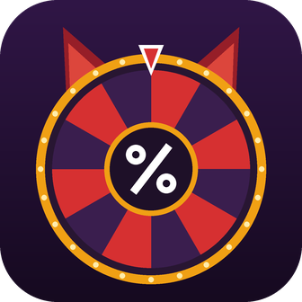

<p align="center">
  
</p>

<h1 align="center">Demon Roulette</h1>

<p align="center">
  A level roulette for Geometry Dash, built right into the game.<br>
  Рулетка уровней для Geometry Dash прямо внутри игры.
</p>

<p align="center">
  <b>English</b> · <a href="#русский">Русский</a>
</p>

---

## English

### Compatibility

| | Version |
|---|---|
| Geometry Dash | **2.2081** |
| Geode (the loader installed in the game) | **5.11.2** |
| Platform | Windows |
| Mod ID | `g0shain.demon-roulette` |

> The mod targets exactly Geode 5.11.2 and GD 2.2081. Other versions are not tested.

> [!WARNING]
> ### Geometry Dash 2.209 is NOT supported yet
> This mod was built for **Geometry Dash 2.2081** and **Geode 5.11.2**.
>
> Geometry Dash 2.209 has already been released, but Geode for 2.209 (Geode v6) is not stable yet, so this mod is **not expected to work on 2.209** for now. It has not been tested there.
>
> The mod is planned to be updated once Geode for the new game version is stable and released. Until then, please stay on **GD 2.2081** if you want to use it, and please do not report problems that appear on 2.209.

### What is it?

Demon Roulette gives you a random level, you have to reach a required percent in it, and then you get the next random level with a higher required percent. A series of such levels is called a **run**.

The first level needs 1%. After you reach the required percent, the next level needs more, until the requirement goes over 100% and the run is complete.

### Features

- **Runs.** Create as many runs as you want, give them names, enter or delete any of them. The runs list uses the in-game list frame. Runs are saved between game sessions.
- **Any difficulty you like.** Regular levels: Auto, Easy, Normal, Hard, Harder, Insane. Demons: Easy, Medium, Hard, Insane, Extreme. Mix them freely for every run. Only rated levels are used, platformer levels are excluded.
- **Two progression modes:**
  - *reached % + 1*: needed 1%, got 2% → the next level needs 3%;
  - *fixed +1 step*: needed 1%, got 2% → the next level needs 2%.
- **Skips.** Set a number of skips for a run or make them infinite. A skip can either add +1% to the requirement (default) or keep it unchanged.
- **Pass window inside the level.** After a death with the required percent reached, the game pauses and a window with *Later* / *Next level* appears. Closing the window never loses your progress.
- **Required-percent bar in the GD style.** It is shown at the top of the level (instead of the standard progress bar), on the level page and in the pause menu (instead of the practice bar).
- **Skip / Next level button** right on the level page, under the back arrow.
- **Real GD level list.** *Enter* on a run opens the standard level browser with all levels of that run: the current one on top, the passed ones below (the lowest one is the 1% level), so you can open any previous level at any time.
- **One Esc to the main menu.** Mod screens and level pages replace each other instead of piling up in the scene stack.

### How percent is counted

- Percent is counted **only after a death or after completing the level**. Leaving a level alive does not count.
- Practice mode and test mode are not counted.
- Playing from a start pos is **not** detected, so it still counts.

### Installation

1. Install [Geode](https://geode-sdk.org) for Geometry Dash 2.2081 (Geode 5.11.2).
2. Download `g0shain.demon-roulette.geode` from the [Releases](../../releases) page.
3. Put it into `Geometry Dash/geode/mods/` and start the game.

### How to play

1. Press the green demon button at the bottom of the main menu.
2. Press **Create run**, pick the difficulties and options, press **Create**. A random level opens.
3. Reach the required percent. After a death with enough percent, a window appears: **Next level** (or **Later**).
4. Use **Skip** on the level page if skips are enabled for the run.
5. To see all levels of a run, press **Enter** next to it in the runs list.

### Settings

The mod settings (*Geode → Mods → Demon Roulette → Settings*) are **default values for new runs**. All of them can be changed again on the *Create run* screen.

| Setting | Description |
|---|---|
| Fixed +1 step | Switch between the two progression modes |
| Skips per run | Number of skips (0 = disabled) |
| Infinite skips | Unlimited skips |
| Skip adds +1% | Whether a skip raises the required percent by 1% |
| Regular levels / Demons | Which difficulties are enabled by default |

### Building from source

Requirements (Windows):

- [Geode CLI](https://github.com/geode-sdk/cli) and the Geode SDK **v5.11.2**
- CMake 3.29+, Git
- LLVM (clang) and Ninja, e.g. `scoop install llvm ninja`
- Visual Studio (or Build Tools) with the *Desktop development with C++* workload and a Windows SDK

```
geode sdk install
cd <sdk folder>
git checkout v5.11.2
geode sdk install-binaries

cd <project folder>
geode build --ninja
```

The SDK version must match the Geode version in the game (5.11.2), and `mod.json` must contain `"geode": "5.11.2"`.

### Notes

- Levels are requested from the official Geometry Dash servers through the in-game level search. A roll can take a few requests.
- If a roll fails, press **Enter** on the run to try again.
- This is an unofficial fan-made mod and is not affiliated with RobTop Games.

Made by **g0shain and Claude :)**.

---

## Русский

### Совместимость

| | Версия |
|---|---|
| Geometry Dash | **2.2081** |
| Geode (загрузчик, установленный в игре) | **5.11.2** |
| Платформа | Windows |
| ID мода | `g0shain.demon-roulette` |

> Мод рассчитан именно на Geode 5.11.2 и GD 2.2081. На других версиях не проверялся.

> [!WARNING]
> ### Geometry Dash 2.209 пока НЕ поддерживается
> Этот мод собран для **Geometry Dash 2.2081** и **Geode 5.11.2**.
>
> Geometry Dash 2.209 уже вышла, но Geode для 2.209 (Geode v6) ещё не стабилен, поэтому мод на 2.209 **пока работать не должен**. Там он не проверялся.
>
> Мод планируется обновить, когда Geode для новой версии игры станет стабильным и выйдет. До тех пор, если хотите им пользоваться, оставайтесь на **GD 2.2081** и не сообщайте о проблемах, которые появляются на 2.209.

### Что это?

Demon Roulette выдаёт случайный уровень, в котором нужно набрать заданный процент, а затем следующий случайный уровень с более высоким требованием. Серия таких уровней называется **забегом** (run).

Первый уровень требует 1%. После выполнения требования следующий потребует больше, пока оно не превысит 100%, тогда забег завершён.

### Возможности

- **Забеги.** Создавайте сколько угодно забегов, давайте им названия, заходите в них и удаляйте. Список забегов оформлен рамкой списков игры. Забеги сохраняются между запусками игры.
- **Любые сложности.** Обычные уровни: Auto, Easy, Normal, Hard, Harder, Insane. Демоны: Easy, Medium, Hard, Insane, Extreme. Сочетайте как угодно для каждого забега. Используются только рейтинговые уровни, платформеры исключены.
- **Два режима прогрессии:**
  - *набранный % + 1*: нужно 1%, набрали 2% → следующему нужно 3%;
  - *фиксированный шаг +1*: нужно 1%, набрали 2% → следующему нужно 2%.
- **Скипы.** Задайте число скипов для забега или сделайте их бесконечными. Скип либо добавляет +1% к требованию (по умолчанию), либо оставляет его прежним.
- **Окно прохождения внутри уровня.** После смерти с набранным нужным процентом игра ставится на паузу и появляется окно *Later* / *Next level*. Закрытие окна никогда не сбрасывает прогресс.
- **Полоска нужного процента в стиле GD.** Показывается сверху в уровне (вместо стандартной полоски прогресса), на странице уровня и в паузе (вместо полоски практики).
- **Кнопка Skip / Next level** прямо на странице уровня, под стрелкой назад.
- **Настоящий список уровней GD.** Кнопка *Enter* у забега открывает стандартный браузер уровней со всеми уровнями забега: сверху текущий, ниже пройденные (самый нижний на 1%). Так в любой момент можно зайти в любой предыдущий уровень.
- **Один Esc до главного меню.** Экраны мода и страницы уровней заменяют друг друга и не накапливаются в стеке сцен.

### Как засчитывается процент

- Процент засчитывается **только после смерти или после прохождения уровня**. Выход из живого уровня не засчитывается.
- Режим практики и тестовый режим не засчитываются.
- Игра со стартпоза **не определяется**, поэтому тоже засчитывается.

### Установка

1. Установите [Geode](https://geode-sdk.org) для Geometry Dash 2.2081 (Geode 5.11.2).
2. Скачайте `g0shain.demon-roulette.geode` на странице [Releases](../../releases).
3. Положите файл в `Geometry Dash/geode/mods/` и запустите игру.

### Как играть

1. Нажмите зелёную кнопку с демоном внизу главного меню.
2. Нажмите **Create run**, выберите сложности и параметры, нажмите **Create**. Откроется случайный уровень.
3. Наберите нужный процент. После смерти с достаточным процентом появится окно: **Next level** (или **Later**).
4. Если для забега включены скипы, используйте **Skip** на странице уровня.
5. Чтобы увидеть все уровни забега, нажмите **Enter** рядом с ним в списке забегов.

### Настройки

Настройки мода (*Geode → Mods → Demon Roulette → Settings*) это **значения по умолчанию для новых забегов**. Их можно ещё раз изменить на экране *Create run*.

| Настройка | Описание |
|---|---|
| Fixed +1 step | Переключение между двумя режимами прогрессии |
| Skips per run | Число скипов (0 = выключены) |
| Infinite skips | Бесконечные скипы |
| Skip adds +1% | Поднимает ли скип требуемый процент на 1% |
| Regular levels / Demons | Какие сложности включены по умолчанию |

### Сборка из исходников

Требования (Windows):

- [Geode CLI](https://github.com/geode-sdk/cli) и Geode SDK **v5.11.2**
- CMake 3.29+, Git
- LLVM (clang) и Ninja, например `scoop install llvm ninja`
- Visual Studio (или Build Tools) с рабочей нагрузкой *Разработка классических приложений на C++* и Windows SDK

```
geode sdk install
cd <папка SDK>
git checkout v5.11.2
geode sdk install-binaries

cd <папка проекта>
geode build --ninja
```

Версия SDK должна совпадать с версией Geode в игре (5.11.2), а в `mod.json` должно стоять `"geode": "5.11.2"`.

### Примечания

- Уровни запрашиваются у официальных серверов Geometry Dash через встроенный в игру поиск уровней. Один бросок может занять несколько запросов.
- Если бросок не удался, нажмите **Enter** у забега, чтобы повторить.
- Это неофициальный фанатский мод, он не связан с RobTop Games.

Сделано **g0shain и Claude :)**.
